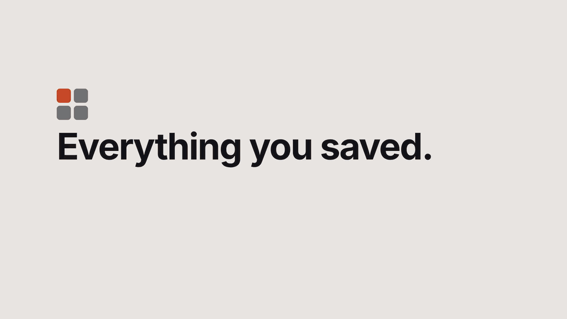

<div align="center">

# SavedMap

**All the things you saved on socials,in one map you own.**

Instagram saves, Pinterest boards, YouTube playlists, Goodreads shelves and Karakeep bookmarks in one searchable library on your own computer, with a map that groups similar things together.

[](LICENSE)




<sub>Every platform in one library → a topic across platforms with related items → zooming into the map and opening an item → searching "pasta recipe". [Full-HD video](docs/demo.mp4) · [how it was made](docs/demo-video/).</sub>

</div>

## Why

You save things to come back to them: a recipe reel, an outfit, a book someone recommended, a 40-minute talk. Then they sit in five apps, each with its own messy list, and you never find them again.

SavedMap downloads your saves and works out what each one is about:
- what's **said** in videos (transcribed locally);
- what's **written** on screen (OCR);
- what it **looks** like (image embeddings);
- a short **English summary**, even when the original is in Italian or anything else.

Then it lets you **find, rediscover and act on** them. Nothing leaves your machine unless you choose a cloud model.

## What you get

- **One library, every platform.** Filter by platform, or by your own collections, boards, shelves and playlists.
- **Topics across platforms.** *Books & reading* shows your Goodreads books *and* the reels and pins about books. You can edit the topic list.
- **Search by meaning.** "that pasta reel", "stoicism", "living room ideas": search covers what's said, shown and written.
- **A map of your taste.** Similar items sit together, by look, by topic, or both, with clusters named automatically. It turns to fit your screen, a Spacing control opens up crowded clusters, and it stays smooth with thousands of thumbnails.
- **Related items.** Open anything and see the 8 most similar saves from every platform: a book leads to the reels about it.
- **One Update button.** It fetches only what's new, then downloads and processes it. A built-in **ban guard** keeps automated access gentle.
- **Comfortable to use, on desktop and phone.** Light/dark/auto theme, keyboard shortcuts, filters kept in the URL, settings in the app, a filter drawer and pinch-to-zoom on mobile. Lighthouse: Performance 99 desktop / 86 mobile, Accessibility 100.

## Platforms

| Platform | How SavedMap reads it | Your login needed? | Guided by |
| --- | --- | --- | --- |
| Instagram | your saved feed, in a real Chrome window, paced like a person | yes, once | `/connect-instagram` |
| Pinterest | boards via [gallery-dl](https://github.com/mikf/gallery-dl)'s client | only for secret boards | `/connect-pinterest` |
| YouTube | Google Takeout playlists and music library; thumbnails only, plays embedded | no | `/connect-youtube` |
| Goodreads | the official library export plus Open Library covers | no | `/connect-goodreads` |
| Karakeep | your own server's REST API, with an API key | no (a key) | `/connect-karakeep` |

Want another platform (Reddit, …)? The `/add-source` skill walks you through a connector. There's one small contract, and tests run without network.

## Quick start

You need Python 3.12 via [uv](https://docs.astral.sh/uv/), ffmpeg and Chrome. An NVIDIA GPU with 4 GB is enough but optional. Developed and tested on Linux; macOS should work but is untested, and Windows is untested.

**With [Claude Code](https://claude.com/claude-code) (recommended):** clone the repo, open Claude Code in it, run `/savedmap-setup`, then `/connect-instagram` (or `-pinterest`, `-youtube`, `-goodreads`, `-karakeep`). The skills check your machine, explain each platform's risk, and run everything step by step.

**By hand:**

```bash
uv sync                                   # Python deps
uv run savedmap init                      # data/ + data/config.toml: enable your platforms there
uv run savedmap connect instagram         # platforms with a login: log in once in the Chrome window
uv run savedmap update --dry-run          # one request per platform to check the connection
uv run savedmap update                    # fetch new saves, download, process, cluster
uv run savedmap serve                     # http://127.0.0.1:8770
```

The first run on a big library is an overnight job. On a GTX 1650 Ti, ~2,800 Instagram posts with ~29 h of audio took about 7 h. After that, updates take minutes.

## Docker (home server)

Syncing needs your logged-in browser and processing wants a GPU, so both stay on your computer. A server can run a read-only copy for every device on your network: browse, map, search and related items, on the CPU (about 2 GB of RAM).

```bash
docker compose up -d                      # builds the CPU image, serves ./data on http://127.0.0.1:8770
```

With an NVIDIA GPU and the [NVIDIA Container Toolkit](https://docs.nvidia.com/datacenter/cloud-native/container-toolkit/latest/install-guide.html), add `compose.gpu.yaml`. It builds the CUDA image, and search runs its models on the GPU (about 3.5 GB of GPU memory):

```bash
docker compose -f compose.yaml -f compose.gpu.yaml up -d --build
```

To make it the default, put `COMPOSE_FILE=compose.yaml:compose.gpu.yaml` in a `.env` file next to `compose.yaml`.

To keep a server copy current, put an executable script at `data/hooks/after-update`. `savedmap update` runs it after every successful update, from the CLI or the Update button. A typical hook copies `savedmap.db` (with `sqlite3 .backup`), `layout.json`, `config.toml`, `thumbs/` and `media/` to the server with rsync, then restarts the container. The hook lives in your data folder, so it stays out of git and the web app can't change it.

## Privacy and accounts

- **Local by default.** Media, database, models and the LLM ([Ollama](https://ollama.com), `qwen3:1.7b`) all run on your machine.
  - Cloud transcription or LLMs are optional: any OpenAI-compatible endpoint, with the key in an environment variable. A full library costs about $1–5.
  - The design doc has the numbers.
- **Gentle with your accounts.** These limits apply to platforms that use your login:
  - at least 12 h between syncs, and 40 requests per update;
  - a full re-read at most once a month;
  - a 72 h pause if the platform pushes back.
- **Use it fairly.** Reading your own saves through a logged-in browser is still automated use of your account, which the platforms' terms don't allow. The skills say this before anything runs. Keep syncs occasional.
- **Your data stays yours.** Unsaved items are kept and marked *no longer saved*. The `data/` folder is self-contained and gitignored.

## How it works

| Stage | Tool | Notes |
| --- | --- | --- |
| Fetch | one small connector per platform | incremental; the shared downloader fetches media without cookies |
| Speech | faster-whisper `large-v3-turbo` (or a cloud API) | music-only reels give no text |
| On-screen text | EasyOCR (it + en) | images and video frames |
| Look | SigLIP2 | also powers text→image search |
| Describe | Qwen3-1.7B on Ollama, pydantic-structured output | English title, summary, tags; skipped for items with no words |
| Topic | multilingual-e5 | text embedding; topics from an editable list |
| Map | UMAP + HDBSCAN | three views; labels are each cluster's most distinctive tags |

Models load one at a time to fit a 4 GB GPU, and search runs on the CPU (on the GPU in a read-only Docker copy that has one). Scope, user journeys, architecture and costs are in [docs/DESIGN.md](docs/DESIGN.md).

## Commands

| Command | What it does |
| --- | --- |
| `update [--source …] [--full] [--dry-run] [--no-process] [--force]` | Everything new from every enabled platform. `--full` re-reads whole lists to notice unsaved items (once a month). `--force` skips waiting intervals, never the pause after pushback. |
| `status` | Items per platform, last sync, next allowed sync |
| `serve` | The app at http://127.0.0.1:8770 |
| `process`, `refine`, `cluster`, `download` | Single pipeline steps; each only does what's missing |
| `migrate` | One time: upgrade a v0.1 Instagram-only data folder |

Tests: `uv run pytest` covers storage, the ban guard, migration, settings and connector parsing, with no network.

## Roadmap

- [Karakeep](https://karakeep.app) and more sources
- A list view and sorting

## Credits

- **Libraries:** [gallery-dl](https://github.com/mikf/gallery-dl), [yt-dlp](https://github.com/yt-dlp/yt-dlp), [Ollama](https://ollama.com), [faster-whisper](https://github.com/SYSTRAN/faster-whisper), [EasyOCR](https://github.com/JaidedAI/EasyOCR), [SigLIP2](https://huggingface.co/google/siglip2-base-patch16-256), [multilingual-e5](https://huggingface.co/intfloat/multilingual-e5-base), [UMAP](https://umap-learn.readthedocs.io) and [Open Library](https://openlibrary.org).
- **Interface:** [Tailwind CSS](https://tailwindcss.com) (prebuilt, `scripts/build_ui.sh`) and a [Lucide](https://lucide.dev) icon subset, designed with the [unslop](https://github.com/heydamir/unslop) skill by Damir Sokolovsky (CC BY 4.0).

## License

[MIT](LICENSE). Third-party files keep their own licenses, listed in [THIRD_PARTY_NOTICES.md](THIRD_PARTY_NOTICES.md): the Lucide icon subset (ISC), the generated Tailwind CSS (MIT) and the `unslop` skill (CC BY 4.0). One dependency, gallery-dl, is GPL-2.0.
